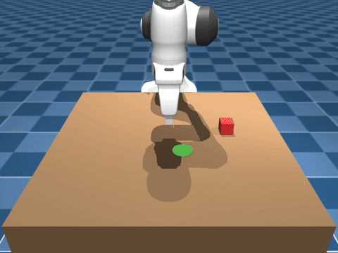
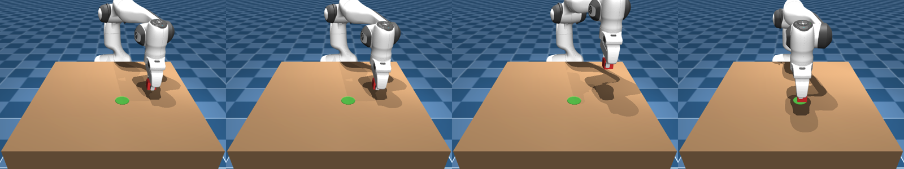

# Panda Pick & Place

A simulated Franka Panda robot arm that learns to pick up a cube and place it on a target, using only a camera image and its own joint positions. Training uses imitation learning: a scripted expert generates demonstrations in [MuJoCo](https://mujoco.org/), and an [ACT](https://arxiv.org/abs/2304.13705) (Action Chunking with Transformers) policy learns to copy them.



*One episode from the scripted expert that generates the training data. Each episode places the red cube and green target at random positions.*

## Results

An ACT policy trained on 150 demonstrations succeeds in **78% of episodes** (39/50) on unseen cube and target positions. An episode counts as a success if the cube ends within 5 cm of the target.

| | |
|---|---|
| Success rate | **78%** (39/50) |
| Final distance, successful episodes | 1.9 cm mean |
| Final distance, failed episodes | 20.7 cm mean |

Most failures come from a dropped grasp or the cube getting knocked away in transit. Per-episode numbers are in [`results/pick_place_150ep.json`](results/pick_place_150ep.json).

## How it works



- **Scene:** a Franka Panda (model from [MuJoCo Menagerie](https://github.com/google-deepmind/mujoco_menagerie)), a table, a 2 cm cube and a target marker.
- **Expert:** an inverse-kinematics state machine that moves through approach → grasp → lift → transport → release. It records the camera images and joint actions for every step.
- **Policy:** ACT, a transformer that takes the front-camera image plus the 8 joint values (7 arm + gripper) and predicts the next 50 joint targets in one shot. Overlapping predictions are averaged to keep motion smooth.

## Usage

You need Python 3.11, [uv](https://docs.astral.sh/uv/), and a GPU for training.

```bash
uv sync
```

Then collect the demonstrations, train, and evaluate:

```bash
# 1. Collect 150 expert demonstrations into data/pick_place/
uv run python sim/collect_data.py --task pick_place --num_episodes 150

# 2. Train ACT
uv run python train.py --task pick_place --chunk_size 50 --temporal_agg --suffix _chunk50_tagg

# 3. Evaluate over 50 episodes and save a video
uv run python sim/evaluate_sim.py --task pick_place \
    --ckpt checkpoints/pick_place_chunk50_tagg/policy_best.ckpt \
    --chunk_size 50 --temporal_agg --num_episodes 50 --video
```

Hyperparameters live in [`config/config.py`](config/config.py).

## In progress

These are being built and have no results yet:

- A Diffusion Policy to compare against ACT.
- Noise robustness: training with camera noise, joint jitter and gripper failures to find out how well the policy might hold up on a real robot.
- Camera and backbone ablations (adding a wrist camera, and swapping in MobileNetV2).

## Credits

- Zhao et al. (2023), [*Learning Fine-Grained Bimanual Manipulation with Low-Cost Hardware*](https://arxiv.org/abs/2304.13705) (ACT)
- [Shaka-Labs/ACT](https://github.com/Shaka-Labs/ACT), the base codebase
- [MuJoCo Menagerie](https://github.com/google-deepmind/mujoco_menagerie), the Franka Panda model (MIT)
